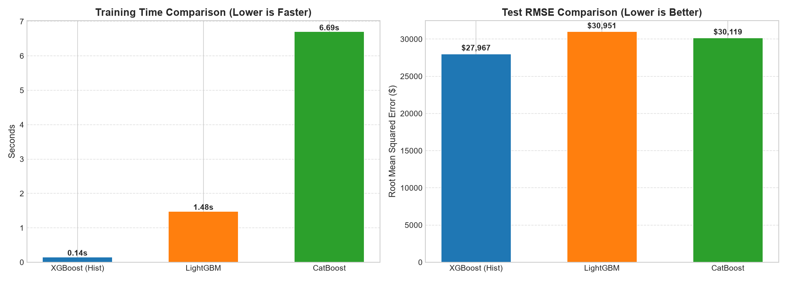
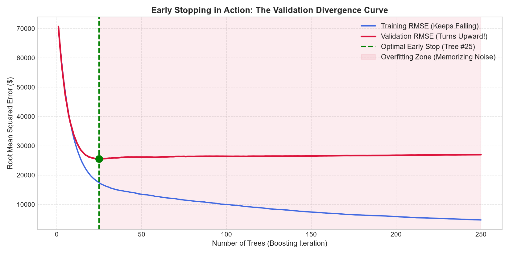
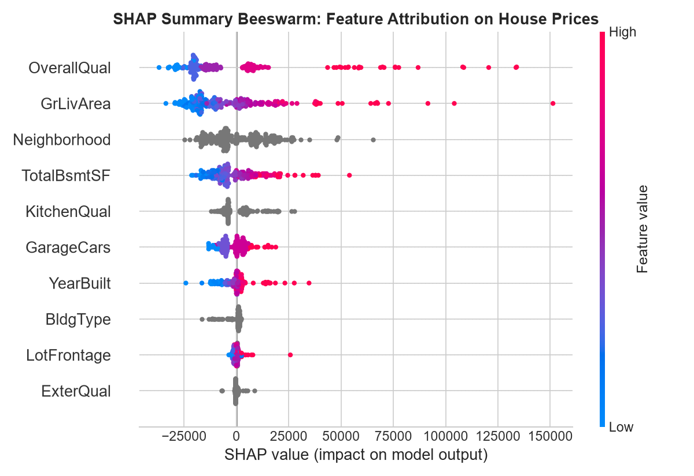

# Gradient Boosted Decision Trees (GBDT): From Zero to Confident

[](https://www.python.org/downloads/)
[]()
[](https://opensource.org/licenses/MIT)

A complete, interactive masterclass designed for beginners and aspiring ML engineers to master **Gradient Boosted Decision Trees (GBDT)** from mathematical first principles to production-grade deployments.

Everything is taught using the **7-step pedagogical method**:
1. The idea in **ONE plain sentence**
2. An intuitive **real-life analogy**
3. A tiny example with **real numbers worked by hand**
4. The math with **every single symbol explained in plain words**
5. Clean Python code **under 15 lines per cell**
6. One **common beginner mistake**
7. One quick **"check yourself" question** with hidden answer

---

## Masterclass Syllabus

| Step | Topic | Core Takeaway |
|:---|:---|:---|
| **Step 1** | **Theory in Plain English** | Boosting vs Bagging, residuals as negative gradients, and 3 manual rounds on 6 rows. |
| **Step 2** | **From-Scratch Implementation** | Pure NumPy GBDT for regression (MSE) and classification (Log-Loss + Newton-Raphson). |
| **Step 3** | **The Big Three Compared** | Head-to-head benchmarking of XGBoost, LightGBM, and CatBoost on Ames Housing. |
| **Step 4** | **Hyperparameter Mastery** | Deep-dive into 6 critical knobs and automated Bayesian optimization with Optuna. |
| **Step 5** | **Early Stopping & Validation** | Tracking the validation divergence curve and freezing weights before memorizing noise. |
| **Step 6** | **Failure Modes & Safe GPU** | Exposing the Generalization Gap and writing robust CUDA detection with CPU fallback. |
| **Step 7** | **Interpretability & SHAP** | Moving beyond split counts with TreeSHAP and global/local beeswarm attributions. |
| **Step 8** | **Active Recall & Challenges** | 8 progressive "Prove It" questions, 3 coding challenges, and 1 real-world extension. |

---

## What You Learn

* **Bagging vs. Boosting:** Why Random Forests average independent crowd votes to reduce variance, while Gradient Boosting runs a relay race where each tree corrects the leftover mistakes of prior trees to slash bias.
* **Residuals as Negative Gradients:** Why minimizing Mean Squared Error ($L = \frac{1}{2}(y - \hat{y})^2$) naturally produces residual targets ($-\frac{\partial L}{\partial \hat{y}} = y - \hat{y}$), turning boosting into gradient descent in function space.
* **Classification via Log-Odds:** Why classification boosting uses regression trees predicting continuous log-odds updates $\gamma = \frac{\sum r}{\sum p(1-p)}$ rather than discrete classes.
* **Architectural Trade-offs:** Level-wise (XGBoost) vs. Leaf-wise (LightGBM) vs. Oblivious/Symmetric (CatBoost) tree growth strategies.
* **Leakage-Free Categoricals:** How CatBoost's **Ordered Boosting** prevents target leakage by calculating statistics exclusively from previous samples in random permutations.
* **Early Stopping Discipline:** The necessity of a strict 3-way partition (Train, Validation, Test) to halt boosting when validation error turns upward.
* **Fair Attribution via SHAP:** Utilizing Lloyd Shapley's cooperative game theory to assign dollar-denominated attributions to every feature.

---

## Head-to-Head Library Comparison (Ames Housing Benchmark)

All three models were evaluated on the identical 80/20 train/test split of the Ames Housing dataset with mixed continuous features, categorical columns, and missing values in `LotFrontage`:

| Dimension / Metric | **XGBoost (Hist)** | **LightGBM** | **CatBoost** |
|:---|:---|:---|:---|
| **Training Speed** | **0.151s** ⚡ | 1.526s | 4.251s (CPU) |
| **Test RMSE** | **$27,677** 🏆 | $31,768 | $30,591 |
| **Test $R^2$ Score** | **0.900** | 0.868 | 0.878 |
| **Tree Growth Strategy** | Level-wise (depth-first) | Leaf-wise (best-first) | Symmetric / Oblivious trees |
| **Categorical Handling** | Experimental partition / One-hot | Integer histogram bin sorting | **Ordered Target Statistics** (Leakage-free) |
| **Missing Values** | Learns default split branch | Dedicated NaN histogram bin | Treats as extreme value (Min/Max) |
| **Tuning Sensitivity** | Moderate (requires depth tuning) | High (requires `num_leaves` tuning) | **Lowest** (best default parameters) |

---

## Visual Benchmarks

### 1. Library Speed & Error Comparison
XGBoost and LightGBM complete in a fraction of a second, with all three algorithms achieving $R^2 > 0.86$ without manual one-hot encoding or mean imputation:



### 2. Early Stopping & The Validation Divergence Curve
While training RMSE falls endlessly toward zero (the illusion of progress), validation RMSE bottoms out around tree #20 and clearly turns upward as the model begins memorizing noise:



### 3. SHAP Beeswarm Feature Attribution
Global ranking meets local directional impact: high `OverallQual` (red) adds up to $+\$100,000$ to house valuations, while low quality (blue) subtracts up to $-\$40,000$:



---

## Production Failure Modes & Failsafe CUDA Detection

1. **Silent Overfitting:**
   * A model with 1,000 deep trees achieves a deceptive Train RMSE of $\approx \$1,000$, but explodes to $\approx \$34,000$ Test RMSE.
   * Monitoring the **Generalization Gap** ($\text{Test RMSE} - \text{Train RMSE}$) exposes this failure immediately.
2. **Defensive Hardware Probe (`get_safe_xgboost_device`):**
   * Automatically probes for NVIDIA GPUs, checks VRAM (tested on 8GB RTX 4060 Laptop GPU), runs a 2-sample warmup fit, and provides an automatic, graceful fallback to CPU if CUDA is unavailable or out of memory.

---

## Repository Structure

```text
gradient-boosting-regression-zero-to-one/
│
├── gradient_boosting_masterclass.ipynb  # The complete, runnable interactive masterclass
├── requirements.txt                    # Verified Python package dependencies
├── .gitignore                          # Ignored caches, checkpoints, models, and data
├── README.md                           # Documentation, benchmarks, and guide
└── figures/                            # High-resolution benchmark plots
    ├── library_benchmark.png           # Speed & RMSE comparison across libraries
    ├── early_stopping_divergence.png   # Train vs. validation error divergence
    └── shap_summary_beeswarm.png       # TreeSHAP feature attributions
```

---

## How to Run Locally

1. **Clone the repository**:
   ```bash
   git clone https://github.com/Arnav-Shrivastava/gradient-boosting-regression-zero-to-one.git
   cd gradient-boosting-regression-zero-to-one
   ```

2. **Create and activate a virtual environment**:
   ```bash
   python -m venv .venv
   # Windows:
   .venv\Scripts\activate
   # Linux/macOS:
   source .venv/bin/activate
   ```

3. **Install dependencies**:
   ```bash
   pip install -r requirements.txt
   ```

4. **Launch the masterclass notebook**:
   ```bash
   jupyter notebook gradient_boosting_masterclass.ipynb
   ```

---

## License & Attribution

Released under the [MIT License](LICENSE). Built for educational excellence and reproducible machine learning.
